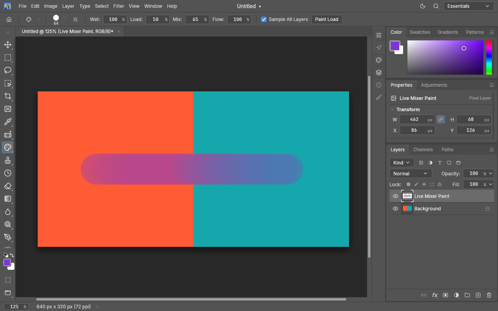

# Incremental Mixer Brush

This change is the foundation of the requested Mixer Brush 2.0 work. It does not
implement the floating palette, harmony wheel, physical brush rack or bristle workshop.
Those must follow qualification of the painting and sampling foundation. These
original studio features do not change Photoshop parity counts.

## Integration with current main (2026-10-20)

The foundation is integrated with upstream `872748fb5b2a53e09dd4e385e31968d985c0515b`
(PhotoCraft 0.11.1). The regular Mixer Brush tool and `paint.mixerBrush` command
use the incremental mixer; there is no separate experimental tool to enable.
The merge retains upstream Color Replacement live strokes, prepared Brush/Pencil
and retouch commits, ordinary-brush symmetry, Alt-Zoom handling and spring-loaded
tool keys. A raw-pointer regression verifies mixed pixels while the button is held,
exact preview/commit equality, one Undo step and return from a temporary Mixer Brush.

The original qualification and timings below remain historical evidence for their
recorded baseline. Current integration results are recorded separately in
`creative-studio-validation.md`; they do not establish hardware tablet or display latency.

## Traced cause

Baseline: upstream main `29f1ff9e90f2581ea2964e3276d85c71ab7e79a0`.
`ui-egui/src/canvas.rs::strokes_live` excludes Mixer Brush. `retouch_ui::finish_stroke`
dispatches `paint.mixerBrush` on pointer release. The engine's `mixer_brush` builds
all dabs and calls `apply_mixer_stroke` inside one document edit. The translucent
trail is therefore not the mixed result. This is deferred tool execution, not an
observed GPU invalidation failure.

The old Sample All Layers path also rendered a single frozen composite spanning
the complete stroke. Later dabs could not sample the paint they just deposited.

## Implemented path

`brush_cmds::mixer_live::LiveMixer` uses the existing `DabGenerator`, `BrushContext`,
copy-on-write document/surfaces and native-channel Mixer Brush algorithm. Its float
working tiles avoid quantizing paint after every dab. The canvas displays that real
document copy and uses the existing damage rectangles and texture updates.

An uncommitted smoothing/end-point tail is calculated on a copy of the incremental
state. It is displayed immediately and never contaminates the next input sample.
Dropping the live transaction cancels painting. Failed live strokes cancel rather
than reverting to a placeholder trail. The recorded command uses the same path and
creates one Undo edit. Release stages the already rendered document for the normal
command dispatcher, guarded by the original document and loaded-paint identity and
exact captured parameters. That one-use cache avoids repainting on release. Recorded
commands include the brush, seed, input samples and initial reservoir for deterministic
replay through the same incremental algorithm. Escape, focus loss, tool changes and
stale document context cancel the UI transaction.

## Sampling semantics

* Sample All Layers defaults on for new Mixer settings. Existing explicit false
  preferences remain false.
* With it on, each dab reads the CPU compositor's visible document immediately
  before depositing paint, including the active layer once. This includes visible
  layers above the target as well as below it. Masks, adjustments, transforms,
  opacity and blend modes follow the CPU compositor. Only the target surface changes.
* With it off, dabs read the evolving target working pixels. An empty target supplies
  no pickup color. Masks/channels always use current-target semantics.
* Selection coverage is applied when the float working result is written to the
  preview target. The next all-layer sample sees that selection-constrained result.
* Alt/Option + primary press loads a 64 x 64 spatial tip reservoir in document
  coordinates. It does not create a document edit, rasterize a layer, or start a
  paint drag. Coverage, tip shape, rotation, flips, aspect and projection are sampled.
  The normalized spatial load follows subsequent dab poses. Resolution is bounded;
  subpixel gaps smaller than a reservoir cell are not losslessly represented.
* Load Brush replaces the spatial load with foreground paint. Clean Brush empties
  it without changing the automatic Load/Clean options, matching current main. A
  cleaned brush stays empty for the next stroke unless the foreground changes or
  Load is chosen. Automatic Clean empties it after a stroke; automatic Load then
  refills the solid-color or sampled spatial tip when enabled. The canonical saved
  setting is `loadAfterStroke`; earlier `reloadAfterStroke` settings still deserialize.
  The loaded reservoir persists during the session, including tool switches;
  restart persistence is not added.
* Native pixel conversion enters the document's CMYK profile scope, as the existing
  brush engine does. The loaded-tip preview uses the document-to-monitor canvas
  transform. Cross-document reservoir color-profile conversion is not implemented;
  reload/sample in the destination document before painting between profiles.

Commands: `brush.mixer.sample`, `brush.mixer.load`, `brush.mixer.clean`,
and the existing `paint.mixerBrush`. UI text uses the existing localization system;
the six paint-load control labels are translated in all 20 supported catalogs.

## Resource envelope and limitations

Mixer size is limited to 1024 pixels, dense footprints to 4,194,304 pixels,
and a stroke to 65,536 input samples and 250,000 dabs. Long input segments are
interpolated into batches of at most 2,048 pixels instead of being rejected.
The live preview alone is limited to 256 working tiles (256 x 256 pixels each).
If that preview budget is exhausted, the UI retains all stroke input and the
last valid preview, then replays the full stroke atomically on release. The
normal command is not subject to the preview tile budget. Escape, focus loss,
and document/tool changes still cancel the retained gesture. Other invalid
requests return errors without committing partial paint. A spatial load uses
64 KiB of float color data. Document snapshots share untouched tiles. These
bounds do not constitute hardware qualification.

No fluid solver or grouped-bristle deformation model is introduced. Existing brush
tip/dynamics support is reused. Windows pen tilt/rotation remain limited by the
existing winit input path. Native Linux Wayland, X11/Wacom, macOS and WebAssembly
hardware interaction must be tested on those systems; simulated pen events do not
establish hardware qualification.

## Verification

`brush_cmds/mixer_live_tests.rs` covers live output, exact commit equivalence at
8/16/32-bit depth, reference-algorithm comparison, cancellation, Undo/Redo, spatial
loading, composite sampling, current-layer behavior, overlap feedback, floating
selection preservation, malformed reservoirs, depletion and reload.
`canvas.rs` covers the pointer-down/move/release and Alt-sampling routes. The existing
Mixer options test verifies the new default and persistence through `tools.setBrush`.

`cargo run --release -p photocraft-engine --example mixer_probe` measures CPU engine
begin/move/prepared-commit costs on a 24 MP three-layer document. It is not an OS pointer-to-
display latency test. Run it under a recorded machine/build configuration and keep
its actual JSON results with the review evidence.

## Original upstream compatibility assessment (2026-10-11)

No PDF Binder #2011 or PDF integration #2751 code is modified. This branch starts
from upstream main, not the PDF branch. Relevant open work inspected on 2026-10-11:
#2131 (precomputed stroke commit), #3098/#2885/#2379 (brush performance), #2902
(GPU tiles), #1911 (Windows pen input), #2516 (tip outline/persistence), #3039
(Stroke Path), #3111 (mask locks). No upstream merge, force push or deployment is
performed. These PRs can change shared canvas/brush code and must be checked again
before integration. The private sibling craftrules checkout was not available.

## Initial measured envelope (2026-10-11)

Windows x64, Intel Core i7-9700K (8 cores), rustc 1.97.1, release with LTO disabled
and 16 codegen units. Synthetic 6000 x 4000 RGB8 document, three layers, 60 input
moves of roughly 10 pixels, spacing 25%, round brush, no simulated bristles.
Initial CPU-only results (milliseconds):

| Brush | Begin | Move median | Move p95 | Move max | Prepared commit | Historical frozen-composite full stroke |
|---|---:|---:|---:|---:|---:|---:|
| 16 px | 1.83 | 0.43 | 1.43 | 2.85 | 0.58 | 12.00 |
| 64 px | 2.73 | 1.36 | 2.37 | 2.62 | 0.64 | 39.22 |
| 256 px | 24.88 | 0.003 | 24.70 | 24.97 | 0.95 | 164.46 |

At 256 px, many 10 px moves emit no dab at 25% spacing, explaining the low median;
the p95/max matter for interaction. The baseline is the historical algorithm's
whole-stroke cost, not baseline frame latency. New live work is distributed over
input updates, so the commit column is not a claim of total algorithm speedup.
The 256 px p95 already exceeds a 16.67 ms / 60 Hz frame budget before GPU presentation.
These measurements do not qualify pen hardware or establish a worst-case memory bound.
The realtime mixer remains PARTIAL as a release qualification, despite the tested
functional slice. The expanded Creative Painting Studio task continues with dense
2K/4K/8K benchmarks, mixer optimization, then a dynamic stamp editor and procedural
tools. Palette, rack, AI guidance/result/comparison and grouped-bristle capabilities
are NOT IMPLEMENTED in this foundation commit. Expensive bristle simulation remains
gated on measured fast-mode performance. Larger brush optimization, full hardware
input qualification, reservoir profile tagging and restart persistence remain open.

Native qualification: 1,207 engine, 84 paint and 1,828 UI unit tests passed, together
with the engine integration tests, command panic hunt, layering, Clippy and WASM
checks. The broad native run stopped at a concurrent GPU rotation-test access
violation on WARP, matching upstream #3212; serial isolation is recorded separately.
`xtask perf --quick` completed but reported over-budget existing canvas scenarios;
successful execution is not a painting-performance PASS. Photoshop menu parity
stays unchanged.

Upstream refreshed on 2026-10-11 to `e44d96e1d4671b8d9fd64fbabdf88fa8abf0441e`.
Ordinary-brush prepared commits (#2131) have now landed and must be preserved on
integration. Open AI PRs #2878 (provider interface / Gemini), #730 (OpenAI), #2879
(options UI), #2995 (subject selection) and #2649 (background removal) were identified.
Provider work must reconcile those existing contributions. No external AI provider
has been invoked, and publishing advanced palette/bristle/AI components requires
the owner's separate release approval after licensing review.

## Current integration visual check

A synthetic orange/teal background and an empty paint layer, painted with a purple
loaded Mixer Brush. The middle capture is taken while the stroke is still held.
The held-stroke and committed canvas RGB pixels are identical.
Captures use the CPU canvas with the Microsoft Basic Render Driver offscreen shell;
they do not qualify physical GPU or tablet latency.

